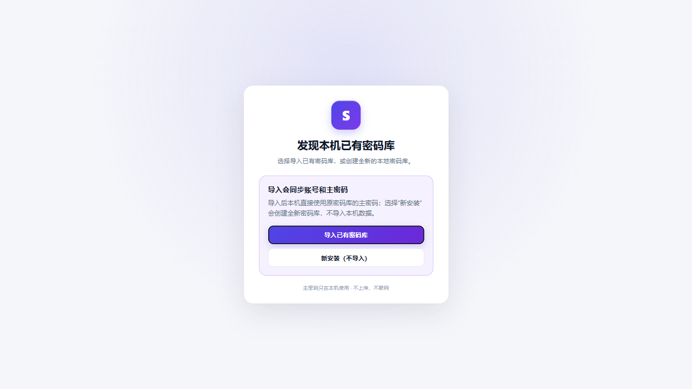
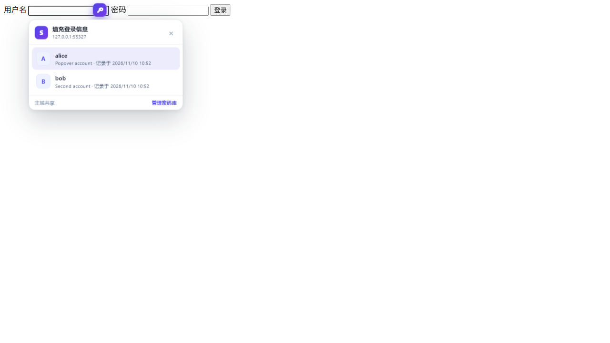

# SubVault · 子域名密码库

[](LICENSE)

一个只在本机运行的 Chromium 密码管理器扩展（Manifest V3）。它按可控的“主域 / 子域”规则保存和填充网页登录密码，支持导入浏览器导出的密码 CSV，并提供完整的本地密码库管理。

当前扩展版本：**v1.2.0**（本机同步宿主包保持 **v1.0.0**，功能未变更）。

- 默认规则：同一主域下的所有子域共享账号（`mail.example.com` ↔ `drive.example.com`）。
- 独立规则：把主域加入“独立主域名”列表后，该主域下每个子域都作为全新域名单独保存、单独匹配。
- 端口规则：可选开启 localhost / IP 按端口隔离；普通 DNS 域名仍忽略端口。
- 数据只保存在本机：PBKDF2-HMAC-SHA512 + AES-256-GCM 加密，无云端、无账号、无统计、无网络请求。
- 记录密码时间：每条密码都有“记录时间”；导入时同一站点组、同一账号出现多个密码，按最新时间覆盖合并。
- 接管 Chrome 自带密码管理器（有限）：标记登录框、检测并清除原生自动填充、使用 SubVault 自有浮层；支持用户名分步登录、iframe 登录和 SPA 登录框；可选关闭 Chrome 的“保存密码”提示。**Chrome 原生钥匙图标和原生密码下拉无法被扩展移除或替换。**
- 站点例外：对个别网站关闭接管、保存提示或钥匙按钮。
- 导入预演：导入前显示新增/更新/合并/冲突，确认后先自动下载加密快照再应用。
- 备份：可包含设置、子域规则和站点例外；支持合并恢复或覆盖恢复；明文 CSV 导出需要再次验证主密码。
- 工具栏角标：显示当前标签页匹配到的已保存账号数量；锁定状态显示锁标记。
- 密码管理：搜索、筛选、弱密码/重复使用/超龄检查、重复账号检测合并、显示/复制、编辑、删除、生成强密码、TOTP 动态码、密码历史回滚、主密码加密备份或独立密码备份。
- 存储自检：设置页显示扩展本地存储占用、密码库条目数和配额，写入失败时给出清理建议。
- 本机跨浏览器同步：可选安装 Native Messaging 宿主，让 Chrome / Edge / Brave 共用同一套加密密码库；B 首次安装会提示导入，不会先创建临时密码库。

---

## 一、域名匹配规则（重点）

所有匹配都由一个**有效站点桶（siteKey）**决定：

| 域名 | 默认规则（未配置） | 配置 `example.com` 为独立主域后 |
| --- | --- | --- |
| `example.com` | 桶 = `example.com` | 桶 = `example.com` |
| `mail.example.com` | 桶 = `example.com` | 桶 = `mail.example.com` |
| `drive.example.com` | 桶 = `example.com` | 桶 = `drive.example.com` |
| `a.mail.example.com` | 桶 = `example.com` | 桶 = `a.mail.example.com` |

- 默认：`mail.example.com` 保存的账号，会在 `drive.example.com`、`example.com` 等同一主域下出现。
- 独立：`mail.example.com`、`drive.example.com` 各自保存、各自匹配，互不共享；`example.com` 本身也独立。
- 配置入口：设置页 → **子域规则** → 添加主域名。
- localhost / IP 端口隔离：设置页 → **子域规则** → 打开“localhost / IP 按端口隔离”。开启后 `localhost:3000` 与 `localhost:4000` 各自独立；`example.com:8080` 仍按主域规则忽略端口。
- 规则修改**不会删除已有数据**；保存、填充、导入合并会立即按新规则执行。
- 主域使用内置的完整 Public Suffix List（ICANN + PRIVATE 段，含 wildcard / exception 规则），离线解析，不联网查询。
- 自动弹出账号选择：可选开启“聚焦时自动弹出”；默认关闭，避免和 Chrome 原生密码下拉重叠。

### PSL（Public Suffix List）说明

PSL 在 SubVault 里只负责一件事：**计算“可注册主域”（eTLD+1），决定默认规则下哪些子域共享账号。** 它不参与加密、存储、同步或填充。

| 当前域名 | 正确主域 | 说明 |
| --- | --- | --- |
| `mail.example.com` | `example.com` | 普通 `.com` 后缀 |
| `mail.example.co.uk` | `example.co.uk` | `co.uk` 是公共后缀 |
| `a.example.com.cn` | `example.com.cn` | `com.cn` 是公共后缀 |
| `project.github.io` | `project.github.io` | `github.io` 是 PRIVATE 段后缀，不同用户不能共享 |
| `bucket.s3.amazonaws.com` | `bucket.s3.amazonaws.com` | PRIVATE 托管后缀，按项目隔离 |
| `a.ck` | `a.ck` | `*.ck` 通配规则 |
| `www.ck` | `www.ck` | `!www.ck` 例外规则 |

为什么不能简单取最后两段：

- `alice.github.io` 和 `bob.github.io` 会都被错误算成 `github.io`，导致无关账号互相出现；
- `mail.example.co.uk` 会被错误算成 `co.uk`；
- 只取最后一段则会把所有 `.com` 站点混在一起。

PSL 的边界：

- 只影响**默认主域共享规则**；
- 把某个主域加入“独立主域名”后，不再按 PSL 聚合，该主域及所有子域各自使用完整主机名；
- localhost / IP 不做 PSL 聚合；
- PSL 不读取端口，普通 DNS 域名仍忽略端口；
- 内置快照包含 **10,406 条规则**，来源是 `https://publicsuffix.org/list/public_suffix_list.dat`；
- 离线文件为 `src/lib/psl-data.js`；更新时执行 `python tools/build-psl.py` 并重新打包，不需要联网运行。

### 导入时的“同域同账号”合并

在**同一个有效站点桶**内，相同账号（用户名忽略大小写）只保留一个当前密码：

1. 比较每条记录的“密码记录时间”（`passwordChangedAt`）。
2. 时间最新的密码胜出。
3. 已有密码库中的记录如果更新，会保留库里的新密码，不会被旧文件覆盖。
4. 默认规则下会跨子域合并；配置了独立主域后，按每个子域分别合并。
5. 没有用户名的记录只按精确主机名分组，避免把不相关的“仅密码”记录合在一起。
6. 如果时间完全相同（例如 Chrome CSV 全部使用同一个文件修改时间），按导入文件中靠后的记录优先。

---

## 二、安装

### 从源码加载（推荐开发/自用）

1. 打开 Chrome 或 Edge：`chrome://extensions`（Edge 为 `edge://extensions`）。
2. 打开右上角“开发者模式”。
3. 点击“加载已解压的扩展程序”，选择本目录（包含 `manifest.json` 的目录）。
4. 安装后打开任意 http/https 网页；已经打开的旧标签页需要刷新一次，内容脚本才会注入。
5. 点击工具栏的 SubVault 图标，创建主密码。

### 从 zip 加载

解压 `dist/subvault-1.2.0.zip`，按上面的步骤加载解压后的目录。

> 需要 Chromium 111+（`chrome.storage.session`、`chrome.privacy`、CSS `color-mix` 等）。

---

## 三、跨浏览器本机同步（可选）

扩展本身不能跨浏览器共享 `chrome.storage`；本机同步需要安装一个 **Native Messaging 宿主**（`native-host/SubVaultSync.exe`）。

### 安装宿主

1. 解压 `dist/subvault-sync-host-1.0.0.zip`；
2. 右键 `install-host.ps1` → 使用 PowerShell 运行，或执行：

```powershell
powershell -NoProfile -ExecutionPolicy Bypass -File .\install-host.ps1
```

安装脚本会为 Chrome、Edge、Brave、Chromium 注册同一宿主；宿主只接受本扩展固定 ID 的连接。

> 当前扩展在 `manifest.json` 中固定了 `key`，扩展 ID 为 `domeipmeogohlofgahadfifjecafipeb`。如果你之前安装的是旧版未固定 ID 的扩展，请先导出加密备份、移除旧扩展，再加载新扩展并恢复备份；否则宿主会因 ID 不匹配而拒绝连接。

### 卸载宿主

```powershell
# 只注销宿主，保留同步数据
powershell -NoProfile -ExecutionPolicy Bypass -File .\uninstall-host.ps1

# 注销宿主并删除宿主同步数据
powershell -NoProfile -ExecutionPolicy Bypass -File .\uninstall-host.ps1 -RemoveData

# 删除宿主程序文件（在宿主目录外执行）
Remove-Item -LiteralPath "D:\SubVaultSyncHost" -Recurse -Force
```

卸载扩展本身请在 `chrome://extensions`（Edge 为 `edge://extensions`，Brave 为 `brave://extensions`）中点击“移除”。

注意：

- 删除扩展会删除该浏览器里的本地密码库，请先导出加密备份；
- `-RemoveData` 会删除宿主目录的 `data` 和 `%LOCALAPPDATA%\SubVaultSync`；
- 卸载宿主不会删除各浏览器扩展自己的本地密码库。

### 首次同步

- 浏览器 A 创建密码库并保存账号后，扩展自动把**加密后的密码库**写入本机宿主；
- 浏览器 B 首次安装后打开设置页或 popup，扩展会先检查本机宿主：
  - 已有数据：显示“发现本机已有密码库”，让用户选择 **导入已有密码库** 或 **新安装（不导入）**；
  - 没有数据：直接进入新密码库设置流程。

导入流程：

- 选择“导入已有密码库”后，输入浏览器 A 的主密码；
- 导入会同时同步账号和主密码；
- **B 不再先创建一个临时新密码库，也不会出现先设密码再导入的混淆流程**；
- 导入后 A/B 使用同一个主密码。

如果选择“新安装（不导入）”，则创建全新密码库，不修改宿主中原有数据，也不会再显示导入提示。



### 实时同步

- 宿主把密码库保存到**宿主 exe 同目录的 `data\state.json`**；若该目录不可写，回退到 `%LOCALAPPDATA%\SubVaultSync\state.json`；
- 每个浏览器通过 Native Messaging 保持连接；
- 一端保存后，宿主更新 revision 并推送给其他浏览器；
- 其他浏览器约 1 秒内拉取并应用（service worker 被休眠时会在下次唤醒重连）；
- 扩展每分钟做一次同步对账（`subvault-sync-poll`），打开设置页/popup 也会立即补拉，避免后台休眠期间漏掉变更。

### 边界

- 仅 Chrome / Edge / Brave / Chromium（Chromium 内核）；Firefox 需要单独移植；
- 同一 Windows 用户下的本地宿主；不同 Windows 用户数据隔离；
- 宿主只保存密文和同步设置，无法解密密码库；
- 两端同时修改同一账号时，当前版本以宿主 revision 冲突提示为主，不会静默覆盖；
- 关闭浏览器后不参与实时同步，下次启动补拉。

### B 浏览器没有出现同步提示

按顺序检查：

1. 宿主目录下是否生成 `data\state.json`；没有生成说明宿主没有连接成功；
2. 在**浏览器 A** 打开一次设置页或 popup，让扩展把已有密码库上传到宿主（旧密码库在宿主安装前创建时尤其需要）；
3. 确认 `HKCU\Software\Google\Chrome\NativeMessagingHosts\com.subvault.sync`（Edge/Brave 对应路径）指向新解压目录的 `com.subvault.sync.json`；
4. 重新在 `chrome://extensions` 加载最新扩展，固定 ID 必须为 `domeipmeogohlofgahadfifjecafipeb`；
5. 浏览器 B 首次打开设置页或 popup，本地尚未创建密码库且宿主有数据时，才会显示“导入已有密码库”提示。

如果宿主目录被移动或重命名，重新运行 `install-host.ps1`，否则注册表里的旧路径会失效。

### 同步没有更新

1. 确认浏览器 A/B 都已解锁；锁定状态下只保存密文，不会应用远程数据；
2. 打开浏览器 B 的设置页或 popup，触发立即补拉（扩展还有每分钟自动对账）；
3. 检查宿主目录下 `data\state.json` 的修改时间是否变化；
4. 两端同时修改同一账号会触发 revision 冲突，当前不会自动合并；
5. 如果浏览器 A 是旧版扩展或没有重新加载，A 的保存不会发布到宿主，请在 `chrome://extensions` 重新加载。

## 四、日常使用

- **填充**：**仅在账号/用户名输入框旁显示** SubVault 悬浮按钮；点击打开账号 popover，选择后自动填入用户名和密码。密码框不再显示按钮，避免重复入口和遮挡。账号框输入会实时过滤账号；输入为空显示全部，不再有独立搜索框。支持 `↑/↓` 选择、`Enter` 填充、`Esc` 关闭；也可按 `Ctrl+Shift+L`（macOS 为 `Command+Shift+L`）显式填充。



- **自动弹出账号选择**：设置 → 安全与接管 → 打开“聚焦时自动弹出账号选择”。开启后点击/聚焦**账号框**会直接打开 popover，仍需点击或回车选择，不会自动提交。默认关闭；如果浏览器自带密码下拉仍存在，建议先删除浏览器保存的密码，再开启此选项，避免两个下拉同时出现。
- **提示位置与主题**：设置页 → 安全与接管 → 保存提示位置，可选左上、右上、左下、右下、居中；“账号已填入 / 新增 / 更新”等所有页面提示都会跟随此位置。主题外观可选跟随系统、浅色、深色，影响扩展页面、popup 和网页内提示。
- **详细提示**：填入时显示账号名和标题；保存时区分“新增账号”和“更新账号”，并显示账号名与站点。
- **锚定位置**：按钮只锚定在账号/用户名输入框内部右侧；密码框不显示按钮。选择账号后同时填入用户名和密码。
- **信息布局**：popover 头部只显示一次当前完整 `host[:port]`；账号行以用户名为主标题，域名不再重复展示，标题/备注为非 URL 时作为次要信息。
- **表单覆盖**：支持普通表单、用户名分步登录、同源 iframe、open shadow DOM；SPA 路由切换后重新扫描。
- **不自动提交**：只填字段，不点击登录按钮，不在页面加载时静默填充。
- **可测试性**：填充 UI 使用 open shadow root，并暴露 `data-subvault-trigger`、`data-subvault-popover`、`data-subvault-account` 稳定标识，便于 Playwright E2E。
- **保存**：鼠标点击登录按钮，或在密码框按 Enter 提交后，才会出现保存提示；提示内容会明确显示“新增/更新账号 + 用户名 + 站点”，并跟随提示位置配置。输入账号/密码、点击输入框、表单自动提交或程序化 submit 都不会触发。
- **跨页面保存**：登录后即使页面跳转，待保存信息会保留最多 15 分钟，并在下一次同站页面提示。默认主域共享规则下，从 `accounts.example.com` 跳到 `app.example.com` 也会继续提示；独立主域下只在同一子域提示。
- **管理**：点击扩展图标 → “管理密码库”，或右键扩展图标 → 选项。popup 的“添加账号 / 管理密码库”固定在域名卡片下方，账号列表单独滚动，账号多时不用滚到底部找按钮；只有密码库视图固定高度，锁定/设置/导入视图按内容自适应。
- **角标**：工具栏图标显示当前标签页匹配的已保存账号数；锁定状态显示锁标记。
- **锁定**：默认空闲 15 分钟自动锁定；也可在 popup 或设置页手动锁定。锁定后解密密钥从内存清除。

### 自动锁定

设置页 → 安全与接管 → 自动锁定：1 / 5 / 15 / 30 / 60 分钟，或“不按时间锁定”。  
自动锁定按**最后一次 SubVault 操作**计时，使用精确 `setTimeout` + 一次性 alarm；修改分钟数会立即重新计算。系统锁屏立即锁定、系统空闲锁定（`chrome.idle`，默认关闭）是独立开关，不受自动锁定分钟数影响，也可手动“立即锁定”。

注意：“不按时间锁定”只关闭无操作计时；如果“系统锁屏时立即锁定”或“系统空闲时锁定”仍开启，系统事件发生时仍会锁定。

### 站点例外

设置页 → 子域规则 → 站点例外，可以按完整主机名关闭：

- 接管 Chrome 自动填充；
- 保存提示；
- 登录框旁的钥匙按钮。

例外可以随时移除，不会删除账号数据。

---

## 五、导入浏览器密码

### Chrome / Edge

1. 打开 `chrome://password-manager/settings`（Edge：`edge://password-manager/settings`）。
2. 选择“导出密码”，保存 CSV。
3. SubVault 设置页 → 导入与导出 → 选择或拖入 CSV。
4. 先查看导入预演：新增、更新、合并、冲突列表；确认后会自动下载一份导入前加密快照，再写入密码库。
5. 导入完成后删除 CSV（它是明文）。

### Firefox / Bitwarden / LastPass / 1Password

同样支持它们导出的 CSV，会自动识别列名：

- Firefox：`url,username,password,httpRealm,formActionOrigin,timePasswordChanged,...`
- Bitwarden：`login_uri,login_username,login_password,...`
- LastPass：`url,username,password,extra,name,...`
- 1Password：`Title,Url,Username,Password,...`

### 时间从哪来

- Firefox 等带时间列的导出：优先读取 `timePasswordChanged`、`passwordChangedAt`、`updatedAt`、`timeCreated`、`timeLastUsed`。
- Chrome / Edge 的 CSV **没有时间列**：使用文件的修改时间（`File.lastModified`）作为记录时间。复制文件可能改变这个时间，重要合并前建议先核对。
- 支持秒、毫秒、微秒时间戳和常见日期字符串。

> CSV 导出是明文；需要长期备份请使用“加密备份”。

---

## 六、接管 Chrome 自带密码管理器

### 实际能做的

- 在登录框上设置 `autocomplete="off"`，降低 Chrome 自动填充触发概率。
- 检测 `:autofill` / `:-webkit-autofill`；仅当 SubVault 已有当前站点账号时，清除 Chrome 原生填入的密码，改由 SubVault 选择账号。
- 使用自己的 Shadow DOM 面板和保存提示。
- 通过 `chrome.privacy.services.passwordSavingEnabled`（设置页开关）关闭 Chrome 的“保存密码”提示。

### 实际做不到的

- Chrome **不允许扩展移除输入框内的原生钥匙图标**。
- 扩展 API 无法让 Chrome 的密码管理器完全停止识别登录表单。
- Chrome 的“保存密码”提示是浏览器全局设置；只有你手动开启 SubVault 的对应开关才会修改，卸载扩展前请先在设置页恢复。

设置页 → 安全与接管：

- **启用接管模式**：默认开启。
- **清除 Chrome 原生自动填充**：默认开启。
- **关闭 Chrome 的“保存密码”提示**：默认关闭，需手动确认。开启后会显示“由 SubVault 关闭”，可一键恢复。
- 完成导入并确认 SubVault 能填充后，可以在 Chrome 密码管理器中删除对应密码，避免两套管理器同时弹窗。

---

## 七、安全模型

- **加密**：PBKDF2-HMAC-SHA512，310,000 次迭代，32 字节随机盐，派生 256 位密钥；AES-256-GCM 加密整个密码库，随机 96 位 IV。旧版 SHA-256 密码库在解锁时会自动升级到 SHA-512 + 32 字节盐。
- **为什么是 PBKDF2**：bcrypt/Argon2 主要用于“口令校验哈希”，不能直接作为 AES 密钥；Argon2 需要引入 WASM 依赖，与“无远程代码、无第三方依赖”的目标冲突。PBKDF2-HMAC-SHA512 是 WebCrypto 原生支持、参数可持久化、可在浏览器离线运行的选择。
- **存储**：
  - `chrome.storage.local`：仅保存密文、KDF 参数、设置。
  - `chrome.storage.session`：解锁期间的派生密钥和待保存候选；内存存储，浏览器关闭即清除。
  - 页面内容脚本永远拿不到完整密码库；只能按当前站点请求单条填充。
- **自动锁定**：默认 15 分钟无操作清除内存密钥，可自定义；也可立即锁定。
- **剪贴板**：复制密码会写入系统剪贴板。设置页可配置 15/30/60/120 秒后尝试清空，并提供“立即清除剪贴板”按钮；如果浏览器不允许读取剪贴板，自动清除会跳过，请使用按钮。
- **备份**：备份包含账号、设置、子域规则和站点例外，不包含主密码或派生密钥。可以填写独立的备份密码，用新的随机盐重新加密；恢复支持合并或覆盖模式，覆盖前会先导出当前快照。独立备份密码不会保存在扩展中。
- **本机同步宿主**：`SubVaultSync.exe` 只保存加密密码库密文和同步设置（`data\state.json`，不可写时回退 `%LOCALAPPDATA%\SubVaultSync`），不接触主密码或派生密钥，不开放网络端口；仅接受固定扩展 ID 的 Native Messaging 连接。
- **无网络**：没有 `fetch` / XHR / WebSocket；扩展页 CSP 设置 `connect-src 'none'`。
- **主密码不可恢复**：首次启动必须由用户创建主密码，没有默认密码或硬编码口令；忘记主密码只能重置密码库（清除本地数据）。
- **主密码与同步**：本机跨浏览器同步使用同一个主密码；B 首次导入时输入 A 的主密码，扩展不会保存明文主密码。
- **路径**：这是浏览器扩展，不使用 `os.path` / 文件路径；数据在 `chrome.storage`，导出文件进入浏览器下载目录（可在 Chrome 设置中修改）。本机同步宿主例外，它使用 `native-host` 目录下的数据文件。
- **HTML 输出**：账号、标题、备注等所有用户数据都通过 `textContent` / DOM 节点写入，不使用 `innerHTML` 拼接，避免 HTML 注入。

### 权限

| 权限 | 用途 |
| --- | --- |
| `storage` | 保存加密密码库与设置 |
| `alarms` | 每分钟检查自动锁定 |
| `idle` | 系统锁屏/空闲时自动锁定 |
| `activeTab` | 读取当前标签页域名 |
| `privacy` | 仅在你手动开启时关闭 Chrome 保存密码提示 |
| `nativeMessaging` | 连接本机同步宿主；不联网，仅在启用本机跨浏览器同步时使用 |
| `clipboardWrite` | 复制密码/验证码到剪贴板 |
| `clipboardRead`（可选） | 设置页手动授权后，校验剪贴板内容再自动清除 |
| `http://*/*`、`https://*/*` | 在登录框提供填充入口，读取当前页面域名 |

不读取页面正文、不注入远程脚本、不上传任何数据。

---

## 八、密码管理功能

设置页 → 密码库：

- 按网站 / 标题 / 用户名搜索。
- 筛选“弱密码 / 重复使用 / 超过 1 年”。
- 显示密码（20 秒后自动隐藏）、复制密码、编辑、删除。
- 新增账号时生成 20 位强密码；字符集包含 `~ ! @ # $ % ^ & * ( ) - _ = + [ ] { } ; : , . ? / |`。
- 显示每条密码的记录时间与相对时间。
- 修改网站域名后，会按当前规则重新归入对应的站点桶。
- 可为账号配置 Base32 TOTP 密钥，在列表中生成 6 位动态码。
- 修改密码时自动保留最近 5 条历史密码，可查看、复制或恢复；历史密码同样在加密库中。

安全概览：

- 账号总数、站点数、弱密码数、重复使用数、超过 1 年未更新数。

导入与导出：

- 明文 CSV（Chrome 兼容）。
- 加密备份 JSON（包含设置、子域规则和站点例外；支持独立备份密码、合并恢复和覆盖恢复；保留精确记录时间）。

---

## 九、目录结构

```
manifest.json
icons/                      图标
src/
  background/service-worker.js   加密库、会话、消息路由、导入合并、接管设置
  content/content.js             登录框识别、填充 UI、保存提示、原生自动填充接管
  popup/                         工具栏弹窗
  options/                       完整设置与密码库管理
  lib/
    crypto.js                    PBKDF2 / AES-GCM / 强度估算
    domain.js                    主域、子域、siteKey 规则
    psl-data.js                  完整 Public Suffix List（离线生成，10,406 条规则）
    csv.js                       CSV 解析、时间戳、导出
    merge.js                     按时间合并导入记录
    totp.js                      TOTP Base32 / HMAC-SHA1
    generator.js                 强密码生成
    client.js                    扩展页面共享工具
native-host/                   Windows Native Messaging 同步宿主（C# / .NET Framework）
  SubVaultSync.exe             已编译宿主
  SubVaultSync.cs              宿主源码
  install-host.ps1             注册 Chrome / Edge / Brave / Chromium
  uninstall-host.ps1           注销宿主，可选 -RemoveData 删除同步数据
  README.txt                   宿主安装/卸载说明
  extension-id.txt             固定扩展 ID（宿主白名单）
tests/                         Node 单元测试、后端集成测试、Playwright E2E
  e2e/extension.spec.js        Playwright 测试运行器 spec
tools/                         图标生成、PSL 生成、清单校验、打包、宿主与 E2E 测试
docs/                          同步/填充界面截图
dist/                          打包产物
```

---

## 十、开发与验证

需要 Node.js 18+（仅开发用，扩展本身不依赖 Node）。

```bash
# 语法检查
node --check src/background/service-worker.js
node --check src/content/content.js
node --check src/popup/popup.js
node --check src/options/options.js

# 单元测试 + 后端集成测试（逐个执行，避免测试运行器再开子进程）
node tests/domain.test.js
node tests/csv.test.js
node tests/merge.test.js
node tests/crypto-generator.test.js
node tests/totp.test.js
node tests/legacy-vault.test.js
node tests/backend.test.js

# 本机同步宿主协议与跨浏览器同步
node tools/test-native-host.mjs
node tools/test-sync-e2e.mjs

# 悬浮 popover / iframe / shadow DOM 填充
node tools/test-popover-e2e.mjs

# 新账号保存提示 / 更新密码提示
node tools/test-save-prompt-e2e.mjs

# 自动锁定时间 / 一次性 alarm / 手动锁定
node tools/test-lock-config-e2e.mjs

# 剪贴板复制 / 锁定 popup 高度
node tools/test-copy-e2e.mjs

# 清单、资源引用、DOM id 校验
node tools/verify-manifest.mjs
node tools/check-dom.mjs

# 重新生成图标
python tools/make_icons.py

# 打包
python tools/package.py
python tools/package_host.py

# Playwright 真实浏览器 E2E
# 1) 安装 Chromium（国内镜像）
$env:PLAYWRIGHT_DOWNLOAD_HOST='https://npmmirror.com/mirrors/playwright'
pnpm exec playwright install chromium
# 2) 直接运行的 API 冒烟测试（已通过）
node tools/playwright-smoke.mjs
# 3) 测试运行器形态（部分环境会卡在 worker 启动）
pnpm exec playwright test
```

E2E 覆盖：加载未打包扩展 → 创建密码库 → 通过设置页添加账号 → 打开本地登录页 → 通过内容脚本填充用户名和密码。  
仓库中的 `tools/playwright-smoke.mjs` 已用 Playwright API + Chromium 实际跑通；官方 `playwright test` CLI 在当前环境会卡在 worker 启动，因此没有把它当作已验证结果。

后端集成测试使用 Node 中的 `chrome` API mock，覆盖：创建密码库、默认主域共享、独立主域隔离、CSV 导入预演与时间合并、独立密码备份/覆盖恢复、站点例外、重复账号合并、localhost 端口隔离、TOTP、密码历史、锁定/解锁。当前共 30 个 Node 测试通过。

Playwright Chromium API E2E 已通过：
- `tools/playwright-smoke.mjs`：创建密码库、添加账号、真实登录页填充；
- `tools/test-popover-e2e.mjs`：用户名/密码框锚定、重复点击稳定性、搜索/键盘、自动弹出、iframe、open shadow DOM、用户名分步登录；
- `tools/test-sync-e2e.mjs`：A 上传、B 首次导入、A 后续修改实时到达 B。

官方 `playwright test` CLI 在当前环境会卡在 worker 启动，因此没有把它当作已验证结果；`tests/e2e/extension.spec.js` 仍保留给可正常运行 Playwright Test 的环境。

本机同步另外有：
- `tools/test-native-host.mjs`：Native Messaging 宿主的 status / publish / pull / revision 冲突；
- `tools/test-sync-e2e.mjs`：浏览器 A 创建并上传，浏览器 B 首次导入，A 后续修改实时到达 B；并模拟 B 的 service worker 重启后补拉漏掉的修改。

填充 UI 另外有：
- `tools/test-popover-e2e.mjs`：真实 Chromium 加载扩展，验证账号框锚定、密码框不显示按钮、输入框实时过滤/空输入显示全部、自动弹出、键盘、iframe、open shadow DOM、用户名分步登录，以及窗口缩放后仍能打开并选择账号；同时校验工具栏角标、详细填入提示、居中位置和深色主题。
- `tools/test-save-prompt-e2e.mjs`：验证输入/点击输入框不弹提示；点击登录按钮或密码框 Enter 后出现“保存登录信息？”，已有账号改密后出现“更新登录密码？”；覆盖 SPA 常见按钮、`<span>登 录</span>`、多 iframe 下只弹一个提示、iframe 内登录由顶层页面显示提示，以及左上/右下/居中提示和 800×500 窗口自适应；校验“已新增账号/已更新账号”详细文案。
- `tools/test-lock-config-e2e.mjs`：验证 1/5 分钟锁定 alarm 的时间、关闭自动锁定会清除 alarm、关闭后保持 65 秒不自动锁定，以及手动锁定立即生效。
- `tools/test-copy-e2e.mjs`：实际打开 popup 并点击密码复制按钮，验证 clipboard 内容和“密码已复制”toast；同时验证 popup/设置页主题、锁定 popup 高度。

同步没有更新时，优先打开一次浏览器 B 的设置页/popup：扩展会立即补拉；后台还有每分钟一次的 `subvault-sync-poll` 对账。若仍不同步，检查两端是否解锁、`data\state.json` 修改时间、扩展是否重新加载，以及是否发生 revision 冲突。

---

## 十一、已知限制

- Chrome 扩展错误页在“重新加载扩展”后不会自动清空历史错误。若源码已经是 v1.2.0（popup 中没有 `copyPassword` 标识），但错误页仍显示旧的 `copyPassword is not a function`，点击错误页右上角“全部清除”，再关闭并重新打开 popup 即可。错误页的源码预览会读取当前文件，因此可能出现“旧错误文字 + 新代码”的现象。

- 登录框位于跨域 iframe 时已尝试注入，但不同站点的框架结构和 CSP 差异较大，仍可能出现无法识别的情况。
- 用户名分步登录已支持只填用户名；如果站点使用完全自定义的 canvas/非 input 登录框，扩展无法填充。
- 浏览器内置密码管理器无法被扩展完全禁用；接管是“尽量抑制 + 自有 UI”。
- Chrome/Edge CSV 无时间列，只能使用文件修改时间；极端情况下合并结果可能受文件复制时间影响。
- 主域识别使用内置完整 PSL 快照；PSL 更新需要重新执行 `python tools/build-psl.py` 并打包。
- 自动填充只处理单密码框的登录表单；注册、改密、多密码框页面不会自动填充或提示保存。
- 本机跨浏览器同步需要安装 Native Messaging 宿主；仅支持 Windows + Chromium 内核浏览器。
- 同步使用同一个主密码：浏览器 B 首次导入需输入浏览器 A 的主密码；选择“新安装”则不会导入，也不会覆盖宿主数据。
- 两端同时修改同一账号时，当前版本依赖宿主 revision 冲突检测，不做自动条目级合并；冲突时保留本地并等待重试。
- 不提供云同步；跨设备仍需使用加密备份手动迁移。
- 填充 UI 使用 open shadow root 以便 Playwright 定位；页面脚本理论上能读取到账号标题/用户名，但读不到密码。若更看重封闭性，可改为 closed shadow + 测试专用接口，但 E2E 可测试性会下降。
- 开启“聚焦时自动弹出”后，如果 Chrome 仍保留自带密码，原生下拉和 SubVault popover 可能同时出现；扩展无法控制原生下拉，建议删除浏览器自带密码。
- 扩展未经过第三方安全审计，请自行评估风险并保留加密备份。

---

## 十二、版本记录

- **v1.2.0**：账号填入/保存/更新等所有页面提示跟随位置配置；提示文案显示账号名、站点，并区分新增/更新；新增主题外观（跟随系统/浅色/深色），统一应用到扩展页面、popup 和网页提示。
- **v1.1.1**：修复 popup 复制密码按钮运行时函数名冲突，点击复制现在有成功/失败 toast。
- **v1.1.0**：修复 popup 复制密码按钮变量遮蔽导致无提示；增加 `clipboardWrite`；账号框实时过滤、移除独立搜索框；保存提示支持点击登录/密码框 Enter，并可配置四角/居中及窗口自适应；保存提示只在顶层页面显示，避免 iframe 重复弹出；popup 按钮上移到域名下方、账号列表独立滚动；工具栏显示当前页账号数角标；修复锁定时间精确性、同步休眠补拉、窗口化 popover 抖动。
- **v1.0.0**：首个公开版本，包含本地加密密码库、主域/子域规则、CSV 导入、TOTP、密码历史、加密备份和本机跨浏览器同步。

## 十三、隐私声明

SubVault 没有服务器、没有账号系统、没有遥测。密码、标题、备注、URL 和设置都只写入当前浏览器配置的本地扩展存储。加密备份由你自行保存；离开本机的只有你主动导出的文件。

启用本机同步后，加密后的密码库密文和同步设置会写入宿主目录下的 `data\state.json`（不可写时回退到 `%LOCALAPPDATA%\SubVaultSync\state.json`），由 Windows 当前用户的 Native Messaging 宿主管理；宿主无法解密主密码，也不开放网络端口。

如果不再使用：先在设置页恢复 Chrome 保存密码提示（如果你开启过），再在 `chrome://extensions` 移除扩展；扩展的本地数据会随扩展移除而删除。需要保留时先导出加密备份。

## 十四、许可证

本项目采用 **GNU General Public License v3.0**，详见 [LICENSE](LICENSE)。
