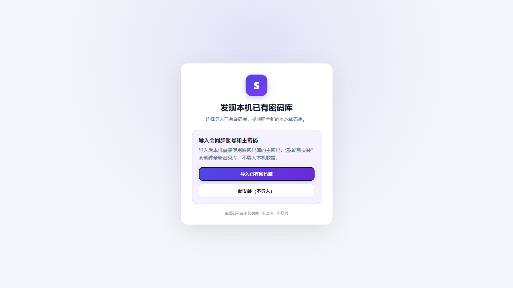
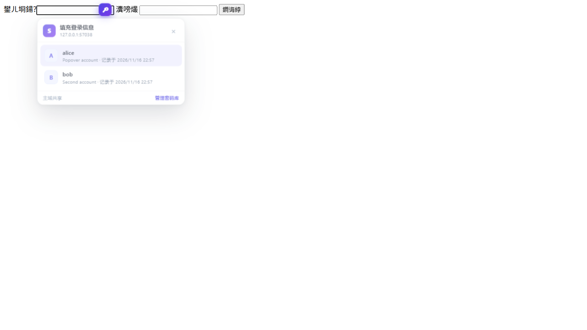

# SubVault · 子域名密码库

[](LICENSE)

一个只在本机运行的 Chromium 密码管理器扩展（Manifest V3）。它按可控的“主域 / 子域”规则保存和填充网页登录密码，支持导入浏览器导出的密码 CSV，并提供完整的本地密码库管理。

当前扩展版本：**v2.3.1**（本机同步宿主包为 **v1.5.1**，支持多密码库隔离路径、Windows Hello + DPAPI 设备快速解锁与独立 WebDAV 备份）。

- 默认规则：同一主域下的所有子域共享账号（`mail.example.com` ↔ `drive.example.com`）。
- 独立规则：把主域加入“独立主域名”列表后，该主域下每个子域都作为全新域名单独保存、单独匹配。
- 端口规则：可选开启 localhost / IP 按端口隔离；普通 DNS 域名仍忽略端口。
- 数据只保存在本机：Argon2id / PBKDF2-HMAC-SHA512 + AES-256-GCM 加密；v4 起主密码派生 KEK，KEK 包装随机 VaultKey，条目由 VaultKey 加密；无云端、无账号、无统计、无网络请求。
- 记录密码时间：每条密码都有“记录时间”；导入时同一站点组、同一账号出现多个密码，按最新时间覆盖合并。
- 接管 Chrome 自带密码管理器（有限）：标记登录框、检测并清除原生自动填充、使用 SubVault 自有浮层；支持用户名分步登录、iframe 登录和 SPA 登录框；可选关闭 Chrome 的“保存密码”提示。**Chrome 原生钥匙图标和原生密码下拉无法被扩展移除或替换。**
- 站点例外：对个别网站关闭接管、保存提示或钥匙按钮。
- 导入：支持 Chrome / Edge / Firefox / Bitwarden / LastPass / 1Password 的 CSV，以及 Bitwarden 未加密 JSON、1Password 1PUX；导入前预演新增/更新/合并/冲突。
- 备份与恢复：导出 AES-256-GCM 加密备份时同时生成 SHA-256 校验文件；显示最近备份时间、超过 30 天提醒；可下载恢复说明，明确本地密码库无法绕过主密码恢复。备份可设置独立密码与有效期，有效期参与 KDF 绑定，过期后原密码也无法解密。
- 组织管理：收藏、文件夹、标签、最近使用排序、批量收藏/删除；支持弱密码/重复/超龄/HTTP 明文/含动态码筛选。
- TOTP：支持 Base32、`otpauth://totp/...`、二维码图片导入；选择账号填充时自动填写当前 OTP 字段。popup 与设置页提供“动态验证码”快捷入口和 30 秒倒计时进度条。
- 工具栏角标：显示当前标签页匹配到的已保存账号数量；锁定状态显示锁标记。
- 材质外观：支持经典纯色、磨砂玻璃、液态玻璃，可配合浅色/深色主题使用；六种组合在 popup、设置页与网页提示中统一生效。
- 解锁即时同步：解锁后已打开的标签页立刻可用，无需刷新。
- 注册场景：注册表单密码框旁提供“⚡ 生成强密码”，自动填入密码与确认框，提交后提示保存新账号。
- 主密码强度：本地 zxcvbn 强制评估（< 50 bits 拒绝，50–59 bits 需勾选确认，≥ 60 bits 通过），全程离线。
- 密钥派生：默认 Argon2id（64 MiB / 3 次迭代 / 并行度 1，hash-wasm 本地 WASM），可在设置中切回 PBKDF2-HMAC-SHA512；旧密码库解锁时透明升级。
- 生成器：长度 8–128、字符集开关、纯数字 PIN、易读模式（剔除 1/l/I/0/O），记住上次参数并跨设备本地保存。
- 离线弱密码检测：内置 10,001 条常见密码的 SHA-256 摘要（不存明文），健康检查直接标记弱密码。
- 隐私遮罩：切换标签页或窗口失焦时立即遮住 popup/设置页内容，可在“通用 → 窗口失焦时自动隐藏内容”关闭；复制密码提示“30 秒后自动清除”。
- 双语界面：可跟随 Chrome UI 语言，也可在设置中强制简体中文 / English（`_locales` + 本地字典，零网络）。
- 可访问性：填充浮层提供 `aria-haspopup` / `aria-expanded` / `aria-activedescendant` 与 roving tabindex，键盘和屏幕阅读器可用。
- Windows Hello 设备快速解锁：启用时创建平台认证器凭据，解锁时先做 Windows Hello 交互验证，再由宿主用 DPAPI 解保护本机 VaultKey；没有可用认证器时无法启用设备快速解锁，主密码始终可回退。
- WebDAV 独立备份：与“本机同步”完全分开，只做加密备份与恢复，不参与实时双向同步；恢复以 WebDAV 备份为准，覆盖当前库并要求重新解锁。
- Passkey 记录：条目可保存 Passkey 的 credentialId、RP ID、账号与备注，随密码库加密和备份；扩展不能创建或使用 Passkey 私钥，界面会明确说明。
- 一次性分享：`.svshare` 使用独立密码加密，过期时间参与 KDF 与 AAD；界面明确“未勾选条目不分享”，默认不勾选任何账号，可按名称/站点/用户名/标签筛选。
- 导出密码：KDBX、加密备份、一次性分享的密码输入框都提供“生成”按钮，生成 20 位易读强随机密码。
- 密钥文件：可选双因素解锁，主密钥由主密码 + 密钥文件共同派生；文件内容不落盘。
- VaultKey 密钥层次（v4）：主密码经 Argon2id/PBKDF2 派生 KEK，KEK 只包装一个随机 VaultKey，条目由 VaultKey 加密；修改主密码或更换密钥文件只重包 VaultKey，不重新加密整个密码库。旧格式密码库首次正确解锁时自动迁移，并保留迁移前的密文备份；设置页可回滚到迁移前格式，下一次解锁会再次迁移。修改主密码或密钥文件后迁移备份会清除，避免用旧凭据回滚。
- 设备快速解锁（v2.2.0，仅 Windows）：启用后由同步宿主使用当前 Windows 用户的 DPAPI 保护一份仅限本机的 VaultKey 副本；扩展不保存主密码，绑定不参与同步。主密码始终可回退；删除密码库、回滚格式或移除绑定时会自动删除宿主侧副本。
- KDBX 互操作：本地导入/导出 KeePass 3/4 `.kdbx`，支持密钥文件、分组、标签、自定义字段、密码历史与附件名；导入前逐条预演，已存在条目默认不勾选。
- PSL 手动更新：设置页导入官方 `public_suffix_list.dat`，自定义规则优先且只保存在本机。
- closed shadow DOM：商店构建使用 closed shadow root，页面脚本无法读取浮层中的账号数据（源码开发构建保留 open 以便测试）。
- 可复现构建：确定性 zip、Dockerfile 与本地双构建校验，同一源码 SHA-256 一致。
- 密码管理：搜索、筛选、弱密码/重复使用/超龄检查、HTTP 明文提示、重复账号检测合并、显示/复制、编辑、删除、生成强密码、TOTP 动态码、密码历史回滚、主密码加密备份或独立密码备份。
- 安全说明：见 [SECURITY.md](SECURITY.md)；隐私政策见 [PRIVACY.md](PRIVACY.md)；商店审核说明见 [REVIEWER.md](REVIEWER.md)；当前版本未经过独立第三方安全审计。
- 存储自检：设置页显示扩展本地存储占用、密码库条目数和配额，写入失败时给出清理建议。
- 本机跨浏览器同步：可选安装 Native Messaging 宿主，让 Chrome / Edge / Brave 共用同一套加密密码库；B 首次安装会提示导入，不会先创建临时密码库。
- 同步状态中心：显示已同步/同步中/冲突/宿主未连接/远端为空等状态、上次同步时间与方向、远端 revision；支持实时/定时/解锁时/仅手动四种触发方式。
- WebDAV 独立备份（可选）：由本机 Native Messaging 宿主代理上传/下载加密密码库，扩展自身仍然零网络；与本机同步完全分开，只做备份与显式恢复。支持 HTTPS、Basic Auth、ETag。WebDAV 凭据只保存在加密密码库内。
- 本地优先同步：把远端版本应用前先生成本地快照，可在同步卡片一键回滚；恢复后不会在解锁瞬间被远端版本再次覆盖。
- 同步触发扩展：实时、固定间隔（5–1440 分钟）、每天固定时间点、解锁时、仅手动；失败按 15 秒起步指数退避，最长 30 分钟。
- 设置中心 8+1：密码库、通用、安全、浏览器接管、域名与站点、同步与备份、导入与导出、分享与旅行、语言与格式、关于；侧栏支持跨分组搜索。
- 界面语言：跟随浏览器 / 简体中文 / English 可手动切换，网页浮层与已打开页面即时生效；日期、相对时间使用对应地区格式。
- 一次性分享：选择条目生成加密 `.svshare` 文件（独立分享密码、1/3/7 天有效期），另一端在设置页离线导入并逐条预演；也可用随包 `companion/index.html` 本地打开查看。离线文件无法真正“阅后即焚”。
- SubVault Companion：随包提供的单文件本地页面，不联网、不上传、无需安装扩展；输入分享密码即可解密并复制账号。
- 邮件别名：条目可记录 SimpleLogin / Firefox Relay / Proton 等掩码邮箱与提供方，参与搜索、CSV/KDBX 导入导出；注册页密码框旁提供“使用别名”入口，点击复制、不自动填入。
- 可配置填充序列：每步支持用户名、密码、动态码、Tab、Enter、等待、点击选择器；最多 20 步，默认不自动提交，可在设置中显式允许 Enter 提交。
- 旅行模式：临时隐藏指定条目、站点或标签；到期自动恢复，也可用主密码立即关闭；隐藏条目不出现于填充列表与角标计数。
- 多密码库：本机最多 20 套独立密码库，每套有独立主密码与加密数据；支持新建、切换、重命名、删除；同步宿主按密码库写入独立文件，WebDAV 写入独立子路径。
- 合并密码库：把另一套密码库的条目合并到当前库，按站点/账号去重并保留较新密码；源库不被修改。
- 资料模板：保存姓名、邮箱、电话、公司、网站、地址等非登录资料，在 popup 中选择后一键填入网页表单；模板与账号一起加密保存。

---

## 一、域名匹配规则（重点）

所有匹配都由一个**有效站点桶（siteKey）**决定：

| 域名 | 默认规则（未配置） | 配置 `example.com` 为独立主域后 |
| --- | --- | --- |
| `example.com` | 桶 = `example.com` | 桶 = `example.com` |
| `mail.example.com` | 桶 = `example.com` | 桶 = `mail.example.com` |
| `drive.example.com` | 桶 = `example.com` | 桶 = `drive.example.com` |
| `a.mail.example.com` | 桶 = `example.com` | 桶 = `a.mail.example.com` |

- 默认：`mail.example.com` 保存的账号，会在 `drive.example.com`、`example.com` 等同一主域下出现。
- 独立：`mail.example.com`、`drive.example.com` 各自保存、各自匹配，互不共享；`example.com` 本身也独立。
- 配置入口：设置页 → **子域规则** → 添加主域名。
- localhost / IP 端口隔离：设置页 → **子域规则** → 打开“localhost / IP 按端口隔离”。开启后 `localhost:3000` 与 `localhost:4000` 各自独立；`example.com:8080` 仍按主域规则忽略端口。
- 规则修改**不会删除已有数据**；保存、填充、导入合并会立即按新规则执行。
- 主域使用内置的完整 Public Suffix List（ICANN + PRIVATE 段，含 wildcard / exception 规则），离线解析，不联网查询。
- 自动弹出账号选择：可选开启“聚焦时自动弹出”；默认关闭，避免和 Chrome 原生密码下拉重叠。

### PSL（Public Suffix List）说明

PSL 在 SubVault 里只负责一件事：**计算“可注册主域”（eTLD+1），决定默认规则下哪些子域共享账号。** 它不参与加密、存储、同步或填充。

| 当前域名 | 正确主域 | 说明 |
| --- | --- | --- |
| `mail.example.com` | `example.com` | 普通 `.com` 后缀 |
| `mail.example.co.uk` | `example.co.uk` | `co.uk` 是公共后缀 |
| `a.example.com.cn` | `example.com.cn` | `com.cn` 是公共后缀 |
| `project.github.io` | `project.github.io` | `github.io` 是 PRIVATE 段后缀，不同用户不能共享 |
| `bucket.s3.amazonaws.com` | `bucket.s3.amazonaws.com` | PRIVATE 托管后缀，按项目隔离 |
| `a.ck` | `a.ck` | `*.ck` 通配规则 |
| `www.ck` | `www.ck` | `!www.ck` 例外规则 |

为什么不能简单取最后两段：

- `alice.github.io` 和 `bob.github.io` 会都被错误算成 `github.io`，导致无关账号互相出现；
- `mail.example.co.uk` 会被错误算成 `co.uk`；
- 只取最后一段则会把所有 `.com` 站点混在一起。

PSL 的边界：

- 只影响**默认主域共享规则**；
- 把某个主域加入“独立主域名”后，不再按 PSL 聚合，该主域及所有子域各自使用完整主机名；
- localhost / IP 不做 PSL 聚合；
- PSL 不读取端口，普通 DNS 域名仍忽略端口；
- 内置快照包含 **10,406 条规则**，来源是 `https://publicsuffix.org/list/public_suffix_list.dat`；
- 离线文件为 `src/lib/psl-data.js`；更新时执行 `python tools/build-psl.py` 并重新打包，不需要联网运行。

### 导入时的“同域同账号”合并

在**同一个有效站点桶**内，相同账号（用户名忽略大小写）只保留一个当前密码：

1. 比较每条记录的“密码记录时间”（`passwordChangedAt`）。
2. 时间最新的密码胜出。
3. 已有密码库中的记录如果更新，会保留库里的新密码，不会被旧文件覆盖。
4. 默认规则下会跨子域合并；配置了独立主域后，按每个子域分别合并。
5. 没有用户名的记录只按精确主机名分组，避免把不相关的“仅密码”记录合在一起。
6. 如果时间完全相同（例如 Chrome CSV 全部使用同一个文件修改时间），按导入文件中靠后的记录优先。

---

## 二、安装

### 从源码加载（推荐开发/自用）

1. 打开 Chrome 或 Edge：`chrome://extensions`（Edge 为 `edge://extensions`）。
2. 打开右上角“开发者模式”。
3. 点击“加载已解压的扩展程序”，选择本目录（包含 `manifest.json` 的目录）。
4. 安装后打开任意 http/https 网页；已经打开的旧标签页需要刷新一次，内容脚本才会注入。
5. 点击工具栏的 SubVault 图标，创建主密码。

### 从 zip 加载

解压 `dist/subvault-2.3.1.zip`，按上面的步骤加载解压后的目录。

> 需要 Chromium 111+（`chrome.storage.session`、`chrome.privacy`、CSS `color-mix` 等）。

---

## 三、跨浏览器本机同步（可选）

扩展本身不能跨浏览器共享 `chrome.storage`；本机同步需要安装一个 **Native Messaging 宿主**。Windows 使用 `native-host/SubVaultSync.exe`（.NET Framework 4.8）；macOS / Linux 使用 Go 单文件宿主，不需要额外运行时。

### 安装宿主

1. 解压 `dist/subvault-sync-host-1.5.1.zip`；
2. Windows：右键 `install-host.ps1` → 使用 PowerShell 运行，或执行：

```powershell
powershell -NoProfile -ExecutionPolicy Bypass -File .\install-host.ps1
```

```bash
# macOS / Linux
./install-host.sh
```

安装脚本会为 Chrome、Edge、Brave、Chromium 注册同一宿主；宿主只接受本扩展固定 ID 的连接。macOS 安装到 `~/Library/Application Support/SubVaultSync`，Linux 安装到 `${XDG_DATA_HOME:-~/.local/share}/subvault-sync`，并把 Native Messaging 清单链接到各浏览器的 `NativeMessagingHosts` 目录。

> 当前扩展在 `manifest.json` 中固定了 `key`，扩展 ID 为 `domeipmeogohlofgahadfifjecafipeb`。如果你之前安装的是旧版未固定 ID 的扩展，请先导出加密备份、移除旧扩展，再加载新扩展并恢复备份；否则宿主会因 ID 不匹配而拒绝连接。

### 卸载宿主

```powershell
# Windows：只注销宿主，保留同步数据
powershell -NoProfile -ExecutionPolicy Bypass -File .\uninstall-host.ps1

# Windows：注销宿主并删除宿主同步数据
powershell -NoProfile -ExecutionPolicy Bypass -File .\uninstall-host.ps1 -RemoveData
```

```bash
# macOS / Linux
./uninstall-host.sh
./uninstall-host.sh --remove-data
```

卸载扩展本身请在 `chrome://extensions`（Edge 为 `edge://extensions`，Brave 为 `brave://extensions`）中点击“移除”。

注意：

- 删除扩展会删除该浏览器里的本地密码库，请先导出加密备份；
- `-RemoveData` / `--remove-data` 会删除宿主的 `data` 目录（Windows 回退路径为 `%LOCALAPPDATA%\SubVaultSync`）；
- 卸载宿主不会删除各浏览器扩展自己的本地密码库。

### 首次同步

- 浏览器 A 创建密码库并保存账号后，扩展自动把**加密后的密码库**写入本机宿主；
- 浏览器 B 首次安装后打开设置页或 popup，扩展会先检查本机宿主：
  - 已有数据：显示“发现本机已有密码库”，让用户选择 **导入已有密码库** 或 **新安装（不导入）**；
  - 没有数据：直接进入新密码库设置流程。

导入流程：

- 选择“导入已有密码库”后，输入浏览器 A 的主密码；
- 导入会同时同步账号和主密码；
- **B 不再先创建一个临时新密码库，也不会出现先设密码再导入的混淆流程**；
- 导入后 A/B 使用同一个主密码。

如果选择“新安装（不导入）”，则创建全新密码库，不修改宿主中原有数据，也不会再显示导入提示。



### 同步状态与触发方式

设置页「安全与接管 → 本机同步」提供状态中心：

- **状态**：已同步、同步中、需要处理（冲突）、宿主未连接、未加入同步、远端为空；
- **信息**：上次同步时间、最近方向（拉取/推送）、远端 revision；
- **触发方式**（仅本机同步）：
  - `实时`（默认）：保存后立刻推送，宿主 revision 变化后立刻拉取；
  - `定时检查`：扩展每分钟对账一次（`subvault-sync-poll`）；
  - `固定时间点`：每天在指定时间执行一次（错过会在下次唤醒补一次）；
  - `解锁时`：每次解锁比较本地与远端时间戳，较新的一方生效；
  - `仅手动`：只在点击「立即同步」时执行。
- **冲突处理**：两端都修改时不会静默覆盖，状态中心会显示本机/远端时间，可选择「使用远端版本」或「保留本机版本」（保留本机会覆盖远端，操作前有确认）。

### WebDAV 独立加密备份

设置页「同步与备份」把两件事分开：

- **本机同步**：只通过 Native Messaging 宿主读写本机固定目录，适合同一台电脑上的不同浏览器；状态、触发方式和冲突处理都在上方卡片。
- **WebDAV 备份（独立）**：只做加密备份与恢复，不参与本机实时同步，也不会与宿主目录互相覆盖。

WebDAV 备份规则：

- 扩展仍然不直接联网；所有请求由本机 Native Messaging 宿主发出。
- 默认库写入 `<WebDAV 地址>/subvault/state.json`；多密码库写入 `<WebDAV 地址>/subvault/<密码库 ID>/state.json`，各库互不覆盖。
- 内容为 `{revision, updatedAt, vault, settings, ignores}`；`vault` 仍是扩展的 Argon2id/PBKDF2 + AES-256-GCM 密文。
- 地址必须是 HTTPS；仅 `http://127.0.0.1` / `http://localhost` 允许用于本机测试。Basic Auth 用户名/密码随每条宿主命令临时传递，宿主不写入磁盘。
- “立即备份到 WebDAV”会检查远端 revision，若远端已有更新的备份会拒绝覆盖并提示先恢复。
- “从 WebDAV 恢复”必须输入当前库的主密码（如启用密钥文件还需选择文件），确认后覆盖当前密码库、清空解锁会话并要求重新解锁；恢复以远端备份数据为准。
- WebDAV 备份与本地同步各用独立的配置和状态，启用/清除 WebDAV 不会改变本机同步。

> WebDAV 服务器必须支持 `GET`、`PUT`、`MKCOL` 和 ETag；不支持 ETag 的服务器会退化为“每次完整拉取/推送”。

### 边界

- 仅 Chrome / Edge / Brave / Chromium（Chromium 内核）；Firefox 需要单独移植；
- 同一 Windows 用户下的本地宿主；不同 Windows 用户数据隔离；
- 宿主只保存密文和同步设置，无法解密密码库；WebDAV 凭据只存在于扩展的加密密码库中，随命令临时传给宿主；
- WebDAV 备份需要宿主进程访问你配置的服务器；扩展本身仍不发起网络请求；
- 本机同步两端同时修改同一账号时会进入冲突状态，由用户在设置页选择保留哪个版本，不会静默覆盖；
- WebDAV 备份不参与实时双向同步，远端更新不会自动覆盖本机；恢复是显式覆盖操作。
- 关闭浏览器后不参与实时同步，下次启动补拉。

### B 浏览器没有出现同步提示

按顺序检查：

1. 宿主目录下是否生成 `data\state.json`；没有生成说明宿主没有连接成功；
2. 在**浏览器 A** 打开一次设置页或 popup，让扩展把已有密码库上传到宿主（旧密码库在宿主安装前创建时尤其需要）；
3. 确认 `HKCU\Software\Google\Chrome\NativeMessagingHosts\com.subvault.sync`（Edge/Brave 对应路径）指向新解压目录的 `com.subvault.sync.json`；
4. 重新在 `chrome://extensions` 加载最新扩展，固定 ID 必须为 `domeipmeogohlofgahadfifjecafipeb`；
5. 浏览器 B 首次打开设置页或 popup，本地尚未创建密码库且宿主有数据时，才会显示“导入已有密码库”提示。

如果宿主目录被移动或重命名，重新运行 `install-host.ps1`，否则注册表里的旧路径会失效。

### 同步没有更新

1. 确认浏览器 A/B 都已解锁；锁定状态下只保存密文，不会应用远程数据；
2. 打开浏览器 B 的设置页或 popup，触发立即补拉（扩展还有每分钟自动对账）；
3. 检查宿主目录下 `data\state.json` 的修改时间是否变化；
4. 两端同时修改同一账号会触发 revision 冲突，当前不会自动合并；
5. 如果浏览器 A 是旧版扩展或没有重新加载，A 的保存不会发布到宿主，请在 `chrome://extensions` 重新加载。

## 四、日常使用

- **填充**：**仅在账号/用户名输入框旁显示** SubVault 悬浮按钮；点击打开账号 popover，选择后自动填入用户名和密码。密码框不再显示按钮，避免重复入口和遮挡。账号框输入会实时过滤账号；输入为空显示全部，不再有独立搜索框。支持 `↑/↓` 选择、`Enter` 填充、`Esc` 关闭；也可按 `Ctrl+Shift+L`（macOS 为 `Command+Shift+L`）显式填充。



- **解锁即时生效**：在 popup 或设置页解锁后，已打开的标签页会收到广播并立即出现账号按钮，无需刷新页面。
- **注册流程**：注册表单（`autocomplete="new-password"`、同表单多个密码框或“注册/Register/Sign Up”按钮）聚焦密码框时会显示“⚡ 生成强密码”按钮；点击后用本地随机数生成并同时填入密码与确认密码框，提交后提示“保存新账号”。
- **独立生成器**：popup 顶部 ⚡ 按钮可独立生成密码，支持长度 8–64、大小写/数字/符号开关、纯数字 PIN、易读模式（剔除易混淆字符），可复制或直接“用于新账号”。
- **主密码强度**：创建/修改主密码时使用本地打包的 zxcvbn 估算强度。低于 50 bits 直接拒绝；50–59 bits 显示红色警告并要求显式勾选确认；≥ 60 bits 通过。评估完全离线，不发送密码。
- **自动弹出账号选择**：设置 → 安全与接管 → 打开“聚焦时自动弹出账号选择”。开启后点击/聚焦**账号框**会直接打开 popover，仍需点击或回车选择，不会自动提交。默认关闭；如果浏览器自带密码下拉仍存在，建议先删除浏览器保存的密码，再开启此选项，避免两个下拉同时出现。
- **提示位置与主题**：设置页 → 安全与接管 → 保存提示位置，可选左上、右上、左下、右下、居中；“账号已填入 / 新增 / 更新”等所有页面提示都会跟随此位置。主题外观可选跟随系统、浅色、深色；界面材质可选经典纯色、磨砂玻璃、液态玻璃，影响扩展页面、popup、账号选择框和网页内提示。
- **统一提示层级**：提示框和 Toast 统一为“账号名主标题 + 动作/站点副标题”；未登录账号时显示站点或动作作为主信息。
- **详细提示**：填入时显示账号名和标题；保存时区分“新增账号”和“更新账号”，并显示账号名与站点。
- **锚定位置**：按钮只锚定在账号/用户名输入框内部右侧；密码框不显示按钮。选择账号后同时填入用户名和密码。
- **信息布局**：popover 头部只显示一次当前完整 `host[:port]`；账号行以用户名为主标题，域名不再重复展示，标题/备注为非 URL 时作为次要信息。
- **表单覆盖**：支持普通表单、用户名分步登录、同源 iframe、open shadow DOM；SPA 路由切换后重新扫描。
- **不自动提交**：只填字段，不点击登录按钮，不在页面加载时静默填充。
- **可测试性**：填充 UI 使用 open shadow root，并暴露 `data-subvault-trigger`、`data-subvault-popover`、`data-subvault-account` 稳定标识，便于 Playwright E2E。
- **保存**：鼠标点击登录按钮，或在密码框按 Enter 提交后，才会出现保存提示；提示内容会明确显示“新增/更新账号 + 用户名 + 站点”，并跟随提示位置配置。输入账号/密码、点击输入框、表单自动提交或程序化 submit 都不会触发。
- **跨页面保存**：登录后即使页面跳转，待保存信息会保留最多 15 分钟，并在下一次同站页面提示。默认主域共享规则下，从 `accounts.example.com` 跳到 `app.example.com` 也会继续提示；独立主域下只在同一子域提示。
- **管理**：点击扩展图标 → “管理密码库”，或右键扩展图标 → 选项。popup 的“添加账号 / 管理密码库”固定在域名卡片下方，账号列表单独滚动，账号多时不用滚到底部找按钮；只有密码库视图固定高度，锁定/设置/导入视图按内容自适应。
- **角标**：工具栏图标显示当前标签页匹配的已保存账号数；锁定状态显示锁标记。
- **锁定**：默认空闲 15 分钟自动锁定；也可在 popup 或设置页手动锁定。锁定后解密密钥从内存清除。

### 自动锁定

设置页 → 安全与接管 → 自动锁定：1 / 5 / 15 / 30 / 60 分钟，或“不按时间锁定”。  
自动锁定按**最后一次 SubVault 操作**计时，使用精确 `setTimeout` + 一次性 alarm；修改分钟数会立即重新计算。系统锁屏立即锁定、系统空闲锁定（`chrome.idle`，默认关闭）是独立开关，不受自动锁定分钟数影响，也可手动“立即锁定”。

注意：“不按时间锁定”只关闭无操作计时；如果“系统锁屏时立即锁定”或“系统空闲时锁定”仍开启，系统事件发生时仍会锁定。

### 站点例外

设置页 → 子域规则 → 站点例外，可以按完整主机名关闭：

- 接管 Chrome 自动填充；
- 保存提示；
- 登录框旁的钥匙按钮。

例外可以随时移除，不会删除账号数据。

---

## 五、导入浏览器密码

### Chrome / Edge

1. 打开 `chrome://password-manager/settings`（Edge：`edge://password-manager/settings`）。
2. 选择“导出密码”，保存 CSV。
3. SubVault 设置页 → 导入与导出 → 选择或拖入 CSV。
4. 先查看导入预演：新增、更新、合并、冲突列表；确认后会自动下载一份导入前加密快照，再写入密码库。
5. 导入完成后删除 CSV（它是明文）。

### Firefox / Bitwarden / LastPass / 1Password

同样支持它们导出的 CSV，会自动识别列名：

- Firefox：`url,username,password,httpRealm,formActionOrigin,timePasswordChanged,...`
- Bitwarden：`login_uri,login_username,login_password,...`
- LastPass：`url,username,password,extra,name,...`
- 1Password：`Title,Url,Username,Password,...`

### Bitwarden JSON / 1Password 1PUX

- Bitwarden：导出**未加密 JSON**，选择文件后自动导入登录项、URI、TOTP、文件夹和标签。
- 1Password：导出 `.1pux`，SubVault 会解压 `export.data`，读取登录字段、URL、TOTP、文件夹和标签。
- 加密的 Bitwarden JSON 会提示先导出未加密版本。
- 两种格式都会进入同一套导入预演、时间合并和导入前加密快照流程。

### 时间从哪来

- Firefox 等带时间列的导出：优先读取 `timePasswordChanged`、`passwordChangedAt`、`updatedAt`、`timeCreated`、`timeLastUsed`。
- Chrome / Edge 的 CSV **没有时间列**：使用文件的修改时间（`File.lastModified`）作为记录时间。复制文件可能改变这个时间，重要合并前建议先核对。
- 支持秒、毫秒、微秒时间戳和常见日期字符串。

> CSV / JSON / 1PUX 导出都是明文或可解密导出文件；需要长期备份请使用“加密备份”。

---

## 六、接管 Chrome 自带密码管理器

### 实际能做的

- 在登录框上设置 `autocomplete="off"`，降低 Chrome 自动填充触发概率。
- 检测 `:autofill` / `:-webkit-autofill`；仅当 SubVault 已有当前站点账号时，清除 Chrome 原生填入的密码，改由 SubVault 选择账号。
- 使用自己的 Shadow DOM 面板和保存提示。
- 通过 `chrome.privacy.services.passwordSavingEnabled`（设置页开关）关闭 Chrome 的“保存密码”提示。

### 实际做不到的

- Chrome **不允许扩展移除输入框内的原生钥匙图标**。
- 扩展 API 无法让 Chrome 的密码管理器完全停止识别登录表单。
- Chrome 的“保存密码”提示是浏览器全局设置；只有你手动开启 SubVault 的对应开关才会修改，卸载扩展前请先在设置页恢复。

设置页 → 安全与接管：

- **启用接管模式**：默认开启。
- **清除 Chrome 原生自动填充**：默认开启。
- **关闭 Chrome 的“保存密码”提示**：默认关闭，需手动确认。开启后会显示“由 SubVault 关闭”，可一键恢复。
- 完成导入并确认 SubVault 能填充后，可以在 Chrome 密码管理器中删除对应密码，避免两套管理器同时弹窗。

---

## 七、安全模型

- **加密**：默认 Argon2id（64 MiB 内存、3 次迭代、并行度 1、32 字节随机盐，输出 256 位密钥）或 PBKDF2-HMAC-SHA512（310,000 次迭代、32 字节盐）。主密码派生的是 KEK，KEK 用 AES-256-GCM 包装随机 32 字节 VaultKey（格式 v4），条目再由 VaultKey 用 AES-256-GCM 加密，随机 96 位 IV。修改主密码或更换密钥文件只重包 VaultKey，不会重新加密整个密码库。旧版 SHA-256 / PBKDF2 密码库在解锁时会透明升级到当前 KDF 参数并迁移到 v4。
- **设备快速解锁**：仅 Windows 同步宿主支持。启用时扩展通过 WebAuthn 平台认证器创建凭据（Windows Hello 交互验证），宿主用 `ProtectedData`（`DataProtectionScope.CurrentUser`）保护一份 32 字节 VaultKey，保存为数据目录下的 `device.json` / `device-<id>.json`，并记录 credentialId。解锁时先做平台认证器断言，再由宿主解保护；旧版本创建且未带凭据的绑定会被拒绝，必须在设置页重新启用，不能退化为无交互解锁。扩展不保存主密码，宿主也不会以明文形式保存 VaultKey。绑定只对当前 Windows 用户和当前设备有效，不参与同步；主密码/密钥文件始终可用作回退。禁用绑定、删除密码库、回滚迁移格式或清空扩展时会尽力删除对应文件。
- **格式迁移与回滚**：迁移前会把原始密文写入本机 `vaultBackup:<密码库 ID>`，新格式先在内存中解包/解密验证通过后才覆盖；迁移失败不会改动原密码库。设置页“密码库格式”卡片显示当前版本与备份时间，可输入主密码回滚；回滚后密码库回到旧格式并锁定，下一次解锁会重新迁移。迁移备份随密码库一起加密保存，不参与同步，也不会上传。
- **为什么默认 Argon2id**：Argon2id 抗 GPU/ASIC 暴力破解能力更强。WASM 模块（hash-wasm 4.12.0，MIT）直接打包在扩展内，`manifest.json` 仅放行 `'wasm-unsafe-eval'`，CSP 仍为 `connect-src 'none'`；不下载远程代码。可在设置中切回纯 WebCrypto 的 PBKDF2。
- **存储**：
  - `chrome.storage.local`：仅保存密文、KDF 参数、设置。
  - `chrome.storage.session`：解锁期间的派生密钥和待保存候选；内存存储，浏览器关闭即清除。
  - 页面内容脚本永远拿不到完整密码库；只能按当前站点请求单条填充。
- **自动锁定**：默认 15 分钟无操作清除内存密钥，可自定义；也可立即锁定。
- **剪贴板**：复制密码会写入系统剪贴板。设置页可配置 15/30/60/120 秒后尝试清空，并提供“立即清除剪贴板”按钮；如果浏览器不允许读取剪贴板，自动清除会跳过，请使用按钮。
- **备份**：备份包含账号、设置、子域规则、站点例外与 Passkey 记录，不包含主密码或派生密钥。可以填写独立的备份密码，用新的随机盐重新加密；恢复支持合并或覆盖模式，覆盖前会先导出当前快照。设置有效期时必须使用独立备份密码，`expiresAt` 会参与 KDF 绑定和 AAD，过期后即使知道原密码也无法解密。独立备份密码不会保存在扩展中。
- **本机同步宿主**：Windows 的 `SubVaultSync.exe` 与 macOS/Linux 的 Go 宿主只保存加密密码库密文和同步设置（可执行文件旁的 `data/state.json`，不可写时回退到用户配置目录），不接触主密码或派生密钥；仅接受固定扩展 ID 的 Native Messaging 连接。启用 WebDAV 备份后，宿主会按配置向 HTTPS 服务器发起 `GET`/`PUT`/`MKCOL` 请求，但不会监听端口，也不会把凭据写入磁盘。设备快速解锁的 DPAPI 绑定文件（`device.json` / `device-<id>.json`）只存在于宿主数据目录，不会上传或同步。
- **密钥文件（双因素解锁）**：可选启用一个任意内容的本地文件。启用后，主密钥由“主密码 + 密钥文件 SHA-256”共同派生；密钥文件内容不写入扩展存储，只参与本地派生。丢失密钥文件无法解锁，需要在设置页明确停用（需主密码 + 当前密钥文件）后才能恢复单密码解锁。
- **KDBX 互操作**：KeePass 2.x `.kdbx` 的导入/导出完全在本地完成（kdbxweb 2.x，MIT，Argon2 由打包的 hash-wasm 提供），不会上传文件；导出密码独立于 SubVault 主密码。
- **一次性分享**：`.svshare` 使用独立分享密码和随机盐加密；v2 起有效期同时参与 KDF salt 绑定与 AES-GCM AAD，修改 `expiresAt` 会导致密钥不一致，过期文件即使知道密码也无法解密。离线文件无法真正“阅后即焚”，界面已明确提示。
- **Passkey 记录**：只保存 credentialId、RP ID、账号与备注，随密码库加密和备份；Chrome 扩展无法导出或使用平台 Passkey 私钥，实际登录仍由系统/网站完成。
- **导出密码生成**：KDBX、加密备份、一次性分享的密码输入框可生成 20 位易读强随机密码；密码只显示在当前页面，关闭后不再保存。
- **closed shadow DOM**：商店构建（`manifest` 带 `update_url`）使用 closed shadow root，页面脚本无法读取填充面板的账号列表；从源码加载的开发构建保留 open shadow root 以便 E2E 测试，二者密码都不会暴露给页面。
- **无网络**：扩展本身没有 `fetch` / XHR / WebSocket；扩展页 CSP 设置 `connect-src 'none'`。只有可选的 WebDAV 备份会让独立的本机宿主进程向用户指定的 HTTPS 服务器发起请求。
- **主密码强度**：创建/修改主密码时，后台用本地打包的 zxcvbn（4.4.2，MIT）做硬校验：< 50 bits 拒绝，50–59 bits 需在 UI 勾选确认，≥ 60 bits 通过；长度至少 10 个字符。zxcvbn 通过静态 import 加载到 MV3 service worker（service worker 禁止动态 `import()`），离线运行。若评估引擎不可用则**失败关闭**，不会放行弱密码。
- **主密码不可恢复**：首次启动必须由用户创建主密码，没有默认密码或硬编码口令；忘记主密码只能重置密码库（清除本地数据）。
- **主密码与同步**：本机跨浏览器同步使用同一个主密码；B 首次导入时输入 A 的主密码，扩展不会保存明文主密码。
- **路径**：这是浏览器扩展，不使用 `os.path` / 文件路径；数据在 `chrome.storage`，导出文件进入浏览器下载目录（可在 Chrome 设置中修改）。本机同步宿主例外，它使用 `native-host` 目录下的数据文件。
- **HTML 输出**：账号、标题、备注等所有用户数据都通过 `textContent` / DOM 节点写入，不使用 `innerHTML` 拼接，避免 HTML 注入。

### 权限

| 权限 | 用途 |
| --- | --- |
| `storage` | 保存加密密码库与设置 |
| `alarms` | 精确调度一次性自动锁定唤醒 |
| `idle` | 系统锁屏/空闲时自动锁定 |
| `activeTab` | 读取当前标签页域名 |
| `privacy` | 仅在你手动开启时关闭 Chrome 保存密码提示 |
| `nativeMessaging` | 连接本机同步宿主（Windows/macOS/Linux 均可）；不联网，仅在启用本机跨浏览器同步时使用 |
| `clipboardWrite` | 复制密码/验证码到剪贴板 |
| `clipboardRead`（可选） | 设置页手动授权后，校验剪贴板内容再自动清除 |
| `http://*/*`、`https://*/*` | 在登录框提供填充入口，读取当前页面域名 |

不读取页面正文、不注入远程脚本、不上传任何数据。

---

## 八、密码管理功能

设置页 → 密码库：

- 按网站 / 标题 / 用户名搜索。
- 筛选“弱密码 / 重复使用 / 超过 1 年”。
- 显示密码（20 秒后自动隐藏）、复制密码、编辑、删除。
- 新增账号时生成 20 位强密码；字符集包含 `~ ! @ # $ % ^ & * ( ) - _ = + [ ] { } ; : , . ? / |`。
- 显示每条密码的记录时间与相对时间。
- 修改网站域名后，会按当前规则重新归入对应的站点桶。
- 可为账号配置 Base32 TOTP 密钥，在列表中生成 6 位动态码。
- 修改密码时自动保留最近 5 条历史密码，可查看、复制或恢复；历史密码同样在加密库中。

安全概览：

- 账号总数、站点数、弱密码数、重复使用数、超过 1 年未更新数。

导入与导出：

- 明文 CSV（Chrome 兼容）。
- Bitwarden JSON、1Password 1PUX。
- KeePass KDBX 3/4：在“导入与导出”中选择 `.kdbx`，可同时提供数据库密码与可选密钥文件；逐条勾选后导入，已存在条目默认不勾选。也可把当前账号导出为 `.kdbx`（导出密码至少 10 位，保留分组、标签、TOTP 与自定义字段）。
- 加密备份 JSON（包含设置、子域规则和站点例外；支持独立备份密码、合并恢复和覆盖恢复；保留精确记录时间）。

域名规则：

- 默认按父域共享；在“独立主域名”中加入某个主域后，它的每个子域都会成为独立站点桶。
- 内置完整 Public Suffix List（ICANN + PRIVATE）。设置页可手动导入官方 `public_suffix_list.dat` 更新后缀规则；自定义规则优先于内置列表，只保存在本机，并可一键清除。

---

## 九、目录结构

```
manifest.json
icons/                      图标
src/
  background/service-worker.js   加密库、会话、消息路由、导入合并、接管设置
  content/content.js             登录框识别、填充 UI、保存提示、原生自动填充接管
  popup/                         工具栏弹窗
  options/                       完整设置与密码库管理
  lib/
    crypto.js                    PBKDF2 / AES-GCM / 强度估算
    domain.js                    主域、子域、siteKey 规则
    psl-data.js                  完整 Public Suffix List（离线生成，10,406 条规则）
    csv.js                       CSV 解析、时间戳、导出
    merge.js                     按时间合并导入记录
    totp.js                      TOTP Base32 / HMAC-SHA1
    generator.js                 强密码生成
    client.js                    扩展页面共享工具
native-host/                   Windows Native Messaging 同步宿主（C# / .NET Framework）
  SubVaultSync.exe             已编译宿主
  SubVaultSync.cs              宿主源码
  install-host.ps1             注册 Chrome / Edge / Brave / Chromium
  uninstall-host.ps1           注销宿主，可选 -RemoveData 删除同步数据
  README.txt                   宿主安装/卸载说明
  extension-id.txt             固定扩展 ID（宿主白名单）
tests/                         Node 单元测试、后端集成测试、Playwright E2E
  e2e/extension.spec.js        Playwright 测试运行器 spec
tools/                         图标生成、PSL 生成、清单校验、打包、宿主与 E2E 测试
docs/                          同步/填充界面截图
dist/                          打包产物
```

---

## 十、开发与验证

需要 Node.js 18+（仅开发用，扩展本身不依赖 Node）。

```bash
# 语法检查
node --check src/background/service-worker.js
node --check src/content/content.js
node --check src/popup/popup.js
node --check src/options/options.js

# 单元测试 + 后端集成测试（逐个执行，避免测试运行器再开子进程）
node tests/domain.test.js
node tests/csv.test.js
node tests/merge.test.js
node tests/crypto-generator.test.js
node tests/crypto-v4.test.js
node tests/totp.test.js
node tests/importers.test.js
node tests/legacy-vault.test.js
node tests/backend.test.js
node tests/strength.test.js
node tests/kdbx-map.test.js
node tests/share.test.js

# Bitwarden JSON 导入 UI
node tools/test-import-e2e.mjs

# 本机同步宿主协议与跨浏览器同步
node tools/test-native-host.mjs
node tools/test-native-host-go.mjs
node tools/test-sync-e2e.mjs

# 悬浮 popover / iframe / shadow DOM 填充
node tools/test-popover-e2e.mjs

# 新账号保存提示 / 更新密码提示
node tools/test-save-prompt-e2e.mjs

# 自动锁定时间 / 一次性 alarm / 手动锁定
node tools/test-lock-config-e2e.mjs

# v1.4.1 新能力：解锁即时同步 / 注册生成 / 弱主密码拒绝 / popup 生成器
node tools/test-v141-e2e.mjs

# v2.1.0：v3 密码库迁移到 VaultKey v4、迁移状态卡片与回滚
node tools/test-vaultkey-e2e.mjs

# Windows Hello + DPAPI 设备快速解锁（宿主协议 + 扩展 E2E）
node tools/test-device-host.mjs
node tools/test-device-unlock-e2e.mjs
node tools/test-hello-gate-e2e.mjs

# WebDAV 独立备份/恢复（mock WebDAV）
node tools/test-webdav-backup-e2e.mjs

# TOTP 快捷面板/倒计时、Passkey 编辑、导出密码生成
node tools/test-totp-passkey-e2e.mjs

# 浅色材质提示条与失焦遮罩开关
node tools/test-toast-privacy-e2e.mjs

# 密钥文件双因素解锁（后台协议 + popup/options UI）
node tools/test-keyfile-e2e.mjs
node tools/test-keyfile-ui-e2e.mjs

# KeePass KDBX 导出 → 删除 → 重新导入
node tools/test-kdbx-e2e.mjs

# v1.6.1：KDBX 密钥文件/逐条预演/分组标签、TOTP 筛选、隐私遮罩、剪贴板提示
node tools/test-v161-e2e.mjs

# 自定义 PSL 导入 / 持久化 / 清除
node tools/test-psl-e2e.mjs

# 双语与可访问性
node tools/test-i18n-e2e.mjs
node tools/test-a11y-e2e.mjs
node tools/test-language-e2e.mjs
node tools/test-settings-nav-e2e.mjs
node tools/test-sync-triggers-e2e.mjs
node tools/test-share-e2e.mjs
node tools/test-vaults-e2e.mjs
node tools/test-v2-features-e2e.mjs
node tools/test-vault-sync-e2e.mjs
node tools/test-alias-fill-e2e.mjs
node tools/test-travel-e2e.mjs
node tools/test-companion-e2e.mjs
node tools/test-theme-materials-e2e.mjs
node tools/check-i18n.mjs

# 剪贴板复制 / 锁定 popup 高度
node tools/test-copy-e2e.mjs

# 清单、资源引用、DOM id 校验
node tools/verify-manifest.mjs
node tools/check-dom.mjs

# 重新生成图标
python tools/make_icons.py

# 打包（确定性 zip：固定时间戳/权限、排序、固定压缩级别）
python tools/package.py
python tools/package_host.py
# 连续执行两次，SHA-256 应完全一致
sha256sum dist/subvault-*.zip

# Playwright 真实浏览器 E2E
# 1) 安装 Chromium（国内镜像）
$env:PLAYWRIGHT_DOWNLOAD_HOST='https://npmmirror.com/mirrors/playwright'
pnpm exec playwright install chromium
# 2) 直接运行的 API 冒烟测试（已通过）
node tools/playwright-smoke.mjs
# 3) 测试运行器形态（部分环境会卡在 worker 启动）
pnpm exec playwright test
```

E2E 覆盖：加载未打包扩展 → 创建密码库 → 通过设置页添加账号 → 打开本地登录页 → 通过内容脚本填充用户名和密码。  
仓库中的 `tools/playwright-smoke.mjs` 已用 Playwright API + Chromium 实际跑通；官方 `playwright test` CLI 在当前环境会卡在 worker 启动，因此没有把它当作已验证结果。

后端集成测试使用 Node 中的 `chrome` API mock，覆盖：创建密码库、默认主域共享、独立主域隔离、CSV 导入预演与时间合并、Bitwarden JSON / 1PUX 解析、独立密码备份/覆盖恢复、站点例外、重复账号合并、localhost 端口隔离、TOTP、收藏标签、密码历史、锁定/解锁。当前共 58 个 Node 测试通过（含 zxcvbn 主密码强度 5 项、生成器/弱密码摘要 7 项、KDBX 映射 7 项、VaultKey 包装 3 项、分享过期绑定 6 项）。

Playwright Chromium API E2E 已通过：
- `tools/playwright-smoke.mjs`：创建密码库、添加账号、真实登录页填充；
- `tools/test-popover-e2e.mjs`：用户名/密码框锚定、重复点击稳定性、搜索/键盘、自动弹出、iframe、open shadow DOM、用户名分步登录；
- `tools/test-import-e2e.mjs`：通过设置页导入 Bitwarden JSON，确认账号、文件夹和 TOTP 元数据写入；
- `tools/test-sync-e2e.mjs`：A 上传、B 首次导入、A 后续修改实时到达 B；
- `tools/test-v141-e2e.mjs`：解锁后标签页即时可用、注册表单内联生成强密码并提示保存、popup 独立生成器、弱主密码被后台拒绝；
- `tools/test-v161-e2e.mjs`：KDBX3 + 密钥文件导入、错误密钥拒绝、逐条预演默认不勾选重复项、分组/标签保留、TOTP 筛选、隐私遮罩、复制提示；
- `tools/test-i18n-e2e.mjs`：`--lang=en-US` 下 manifest 名称、popup、设置页与内容浮层均为英文；
- `tools/test-a11y-e2e.mjs`：账号框 `aria-haspopup/expanded/controls`、listbox/option 语义、roving tabindex、方向键与 Esc 行为；
- `tools/test-hello-gate-e2e.mjs`：伪造平台认证器，验证启用设备解锁会先走 Windows Hello 创建凭据，锁定后必须完成断言才能调用 DPAPI 解锁；
- `tools/test-totp-passkey-e2e.mjs`：TOTP popup/设置页快捷面板与倒计时、Passkey 记录回填、KDBX/备份密码生成按钮；
- `tools/test-toast-privacy-e2e.mjs`：浅色磨砂/液态提示条文字对比度、失焦遮罩开关。

官方 `playwright test` CLI 在当前环境会卡在 worker 启动，因此没有把它当作已验证结果；`tests/e2e/extension.spec.js` 仍保留给可正常运行 Playwright Test 的环境。

本机同步另外有：
- `tools/test-native-host.mjs`：Native Messaging 宿主的 status / publish / pull / revision 冲突；
- `tools/test-sync-center-e2e.mjs`：两个 profile 的状态中心、四种触发方式、冲突 UI 与“使用远端版本”；
- `tools/test-webdav-host.mjs`：Go/C# 宿主的 WebDAV 协议（Basic Auth、MKCOL、ETag/304/412、错误密码、非 HTTPS 拒绝）；
- `tools/test-webdav-backup-e2e.mjs`：WebDAV 独立备份/恢复；本机修改后备份、修改本地库、用主密码恢复并重新解锁，确认恢复以远端备份为准且不影响本机同步；
- `tools/test-sync-e2e.mjs`：浏览器 A 创建并上传，浏览器 B 首次导入，A 后续修改实时到达 B；并模拟 B 的 service worker 重启后补拉漏掉的修改。

填充 UI 另外有：
- `tools/test-popover-e2e.mjs`：真实 Chromium 加载扩展，验证账号框锚定、密码框不显示按钮、输入框实时过滤/空输入显示全部、自动弹出、键盘、iframe、open shadow DOM、用户名分步登录，以及窗口缩放后仍能打开并选择账号；同时校验工具栏角标、账号主标题 Toast、居中位置、深色主题、液态玻璃材质和 OTP 自动填充。
- `tools/test-save-prompt-e2e.mjs`：验证输入/点击输入框不弹提示；点击登录按钮或密码框 Enter 后出现保存提示，已有账号改密后出现更新提示；覆盖 SPA 常见按钮、`<span>登 录</span>`、多 iframe 下只弹一个提示、iframe 内登录由顶层页面显示提示，以及左上/右下/居中提示和 800×500 窗口自适应；校验账号主标题、保存/更新动作 kicker 和详细 Toast。
- `tools/test-lock-config-e2e.mjs`：验证 1/5 分钟锁定 alarm 的时间、关闭自动锁定会清除 alarm、关闭后保持 65 秒不自动锁定，以及手动锁定立即生效。
- `tools/test-copy-e2e.mjs`：实际打开 popup 并点击密码复制按钮，验证 clipboard 内容和“密码已复制”toast；同时验证 popup/设置页主题、材质、锁定 popup 高度。

同步没有更新时，优先打开一次浏览器 B 的设置页/popup：扩展会立即补拉；后台还有每分钟一次的 `subvault-sync-poll` 对账。若仍不同步，检查两端是否解锁、`data\state.json` 修改时间、扩展是否重新加载，以及是否发生 revision 冲突。

---

## 十一、隐私与可复现构建

- 隐私政策：[PRIVACY.md](PRIVACY.md) —— 纯本地、零收集、零网络。
- Companion 是随包的单文件本地页面（`companion/index.html`），不发起网络请求；解密只在浏览器内存中完成。
- 商店审核说明：[REVIEWER.md](REVIEWER.md) —— 权限逐项理由、数据清单、Native Messaging 边界、构建复现步骤。
- 可复现构建：`tools/package.py` 生成确定性 zip（条目时间固定为 1980-01-01、权限固定、路径排序、压缩级别 9），同一源码连续构建的 SHA-256 相同。也可用 `Dockerfile` 复现。压缩包内包含 zxcvbn（~820 KB，压缩后约 400 KB），因此 zip 体积明显增大。

## 十二、已知限制

- Chrome 扩展错误页在“重新加载扩展”后不会自动清空历史错误。若源码已经是 v1.4.0（popup 中没有 `copyPassword` 标识），但错误页仍显示旧的 `copyPassword is not a function`，点击错误页右上角“全部清除”，再关闭并重新打开 popup 即可。错误页的源码预览会读取当前文件，因此可能出现“旧错误文字 + 新代码”的现象。

- 登录框位于跨域 iframe 时已尝试注入，但不同站点的框架结构和 CSP 差异较大，仍可能出现无法识别的情况。
- 用户名分步登录已支持只填用户名；如果站点使用完全自定义的 canvas/非 input 登录框，扩展无法填充。
- 浏览器内置密码管理器无法被扩展完全禁用；接管是“尽量抑制 + 自有 UI”。
- Chrome/Edge CSV 无时间列，只能使用文件修改时间；极端情况下合并结果可能受文件复制时间影响。
- 主域识别使用内置完整 PSL 快照；PSL 更新需要重新执行 `python tools/build-psl.py` 并打包。
- 自动填充只处理登录表单；注册页会在密码框旁提供“生成强密码”芯片并在提交后提示保存，但不会把已有账号自动填进注册表单。
- Chrome 扩展无法创建或使用 Passkey 私钥；Passkey 功能只保存凭据记录，实际认证仍依赖系统/网站。
- 本机跨浏览器同步需要安装 Native Messaging 宿主；支持 Windows / macOS / Linux 上的 Chromium 内核浏览器，宿主包提供 5 个平台二进制。
- 设备快速解锁仅支持 Windows 同步宿主；macOS/Linux 宿主明确返回不支持。绑定与本机 Windows 用户绑定，换机、重装系统或宿主数据目录丢失后只能使用主密码（以及密钥文件）解锁。启用时优先要求 Windows Hello 交互验证（WebAuthn 平台认证器）；浏览器/系统不支持平台认证器时无法启用设备快速解锁，只能使用主密码（以及密钥文件）。
- 同步使用同一个主密码：浏览器 B 首次导入需输入浏览器 A 的主密码；选择“新安装”则不会导入，也不会覆盖宿主数据。
- 本机同步两端同时修改同一账号时，当前版本依赖宿主 revision 冲突检测，不做自动条目级合并；冲突时保留本地并等待重试。WebDAV 备份不做实时合并，只有显式备份/恢复。
- 不提供云同步；跨设备仍需使用加密备份手动迁移。
- 从源码加载的开发构建使用 open shadow root 以便 Playwright 定位，页面脚本理论上能读取账号标题/用户名但读不到密码；Chrome Web Store 构建（manifest 含 `update_url`）自动切换为 closed shadow root，页面脚本无法访问面板内部。
- 开启“聚焦时自动弹出”后，如果 Chrome 仍保留自带密码，原生下拉和 SubVault popover 可能同时出现；扩展无法控制原生下拉，建议删除浏览器自带密码。
- 扩展未经过第三方安全审计，请自行评估风险并保留加密备份。

---

## 十三、版本记录

- **v2.3.1**：修复旧版设备绑定缺少 Windows Hello 凭据时可能绕过 PIN 直接解锁的问题（宿主强制校验 credentialId，旧绑定需重新启用）；WebDAV 备份卡片迁移到“同步与备份”，统一地址/用户名/密码输入宽度与备份/恢复按钮布局。
- **v2.3.0**：一次性分享升级 v2（`expiresAt` 参与 KDF 与 AAD），新增分享筛选、默认不勾选与“未勾选条目不分享”提示；加密备份升级 v5（有效期绑定 KDF，独立密码必填）；KDBX/备份/分享导出增加强随机密码生成按钮；TOTP 增加 popup 快捷入口与倒计时进度；Passkey 记录随条目加密/备份；WebDAV 改为独立加密备份与显式恢复，与本机同步彻底分离；Windows Hello 平台认证器 + DPAPI 设备快速解锁；统一文件选择控件。
- **v2.2.1**：统一文件选择控件（PSL、KDBX、密钥文件、分享导入等）为“选择文件 + 文件名”样式；一次性分享新增账号筛选，并改为默认不勾选，避免误分享整个密码库。
- **v2.2.0**：新增 Windows DPAPI 设备快速解锁：宿主保存受当前 Windows 用户保护的 VaultKey 副本，扩展不保存主密码；popup/设置页可启用、移除与一键解锁，主密码始终可回退；删除密码库、回滚迁移格式或清空扩展会清理绑定。修复浅色磨砂/液态材质下提示条白底白字，新增“窗口失焦时自动隐藏内容”开关。
- **v2.1.0**：引入 v4 VaultKey 密钥层次（KEK 包装随机 VaultKey，条目由 VaultKey 加密）；修改主密码/更换密钥文件只重包 VaultKey；旧 v3/legacy 密码库首次解锁自动迁移并保留本机密文备份；设置页新增“密码库格式”卡片，可查看版本与备份时间、用主密码回滚。修复注册页别名按钮遮挡密码框点击的问题。
- **v2.0.0**：新增多密码库（最多 20 套、独立主密码、新建/切换/重命名/删除、同步路径按库隔离）、密码库合并、非登录资料模板填充；锁屏与设置页支持选择密码库。 随包增加本地 Companion（`companion/index.html`）用于离线解密 `.svshare`；注册页新增“使用别名”入口（点击复制、不自动填入）；六种主题/材质组合核对通过。
- **v1.10.0**：设置页重组为 8+1 分组并支持跨分组搜索；新增扩展内语言偏好（跟随浏览器/简中/英文）、固定间隔与每天固定时间点同步触发、失败指数退避、WebDAV 本地快照与一键回滚；新增一次性加密分享、邮件别名、可配置填充序列和旅行模式。
- **v1.9.0**：统一提示组件（标题/正文空值回退、`role=status`、`aria-live`、防二次翻译），新增 `tools/check-i18n.mjs` 字典完整性检查；新增语言偏好与运行时切换，日期/相对时间按语言格式化。
- **v1.8.0**：新增 WebDAV 密文同步：由 Native Messaging 宿主代理 `GET`/`PUT`/`MKCOL`，扩展自身仍零网络；固定 `<地址>/subvault/state.json`，HTTPS/Basic Auth/ETag 条件请求与冲突检测，凭据只保存在加密密码库；同步状态中心增加传输方式选择与 WebDAV 配置卡片。
- **v1.7.0**：新增同步状态中心（状态、上次同步时间/方向、远端 revision、四种触发方式），同步错误分类与持久化，冲突 UI 支持“使用远端版本/保留本机版本”，改善 service worker 重启后的同步恢复与手动对账。
- **v1.6.1**：KDBX 完整化（KDBX3/4、密钥文件、分组/标签/自定义字段/密码历史/附件名、逐条预演且重复项默认不勾选、独立导出密码）；新增“含动态码”筛选、popup/设置页隐私遮罩、复制密码“30 秒后自动清除”提示；密码库增加 `cipher` 字段预留算法标识。
- **v1.6.0**：新增密钥文件双因素解锁、KeePass KDBX 导入/导出、公共后缀列表（PSL）手动导入与刷新、closed shadow DOM 商店构建；同步宿主重写为 Go 单文件并支持 macOS/Linux（宿主包 v1.1.0）。
- **v1.5.0**：默认 Argon2id（PBKDF2 可选）、密码生成器升级（易读模式/PIN/记忆参数）、离线 10,000 弱密码摘要检测、完整中英双语界面、填充面板键盘与读屏可访问性；可复现构建与审核/隐私文档。
- **v1.4.1**：解锁后页面即时恢复填充、注册/登录场景识别与内联强密码生成、popup 独立生成器、主密码 zxcvbn 强度强制校验（<50 bits 拒绝、50–59 bits 需确认）、可复现构建、`REVIEWER.md` / `PRIVACY.md`。
- **v1.4.0**：补齐 P0 实用功能：TOTP 二维码/otpauth 导入与 OTP 自动填充；Bitwarden 未加密 JSON、1Password 1PUX 导入；收藏、标签、文件夹、最近使用、HTTP 明文筛选；加密备份 SHA-256 校验、恢复说明和备份提醒；新增 `SECURITY.md` 与发布校验文件。
- **v1.3.2**：提示视觉层级和材质外观；测试环境兼容与单元测试稳定性修复。
- **v1.3.1**：popup 保存提示也改为账号主标题、动作/站点副标题，统一全部提示的信息层级。
- **v1.3.0**：提示视觉层级统一（账号为主标题、动作/站点为副标题）；新增经典纯色/磨砂玻璃/液态玻璃材质；账号提示、保存/更新提示和扩展页面统一使用材质与主题。
- **v1.2.0**：账号填入/保存/更新等所有页面提示跟随位置配置；提示文案显示账号名、站点，并区分新增/更新；新增主题外观（跟随系统/浅色/深色），统一应用到扩展页面、popup 和网页提示。
- **v1.1.1**：修复 popup 复制密码按钮运行时函数名冲突，点击复制现在有成功/失败 toast。
- **v1.1.0**：修复 popup 复制密码按钮变量遮蔽导致无提示；增加 `clipboardWrite`；账号框实时过滤、移除独立搜索框；保存提示支持点击登录/密码框 Enter，并可配置四角/居中及窗口自适应；保存提示只在顶层页面显示，避免 iframe 重复弹出；popup 按钮上移到域名下方、账号列表独立滚动；工具栏显示当前页账号数角标；修复锁定时间精确性、同步休眠补拉、窗口化 popover 抖动。
- **v1.0.0**：首个公开版本，包含本地加密密码库、主域/子域规则、CSV 导入、TOTP、密码历史、加密备份和本机跨浏览器同步。

## 十四、隐私声明

SubVault 没有服务器、没有账号系统、没有遥测。密码、标题、备注、URL 和设置都只写入当前浏览器配置的本地扩展存储。加密备份由你自行保存；离开本机的只有你主动导出的文件。

启用本机同步后，加密后的密码库密文和同步设置会写入宿主目录下的 `state.json` / `vault-<id>.json`（不可写时回退到 `%LOCALAPPDATA%\SubVaultSync`），由当前用户的 Native Messaging 宿主管理。启用 WebDAV 备份后，宿主只把你指定的 Base URL 与 `/subvault/state.json`（多库为 `/subvault/<id>/state.json`）组合后上传，不会扫描其他路径。设备快速解锁的 DPAPI 绑定文件只在本机宿主目录，包含受保护 VaultKey 与平台凭据 ID，不上传、不同步。宿主无法解密主密码，也不监听网络端口。

如果不再使用：先在设置页恢复 Chrome 保存密码提示（如果你开启过），再在 `chrome://extensions` 移除扩展；扩展的本地数据会随扩展移除而删除。需要保留时先导出加密备份。

## 十五、许可证

本项目采用 **GNU General Public License v3.0**，详见 [LICENSE](LICENSE)。
